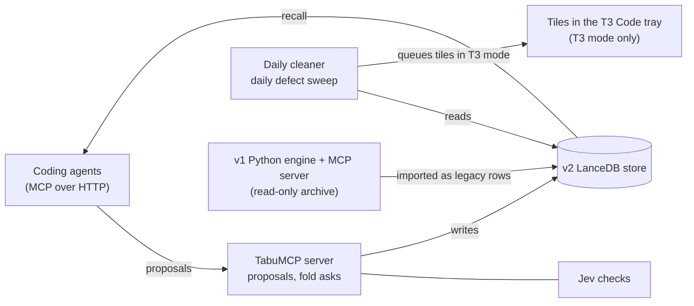

# TabuMCP: the Tabularium memory server

TabuMCP gives coding agents a long-term memory they share across sessions. It runs as one local user service on 127.0.0.1 and serves MCP over HTTP to every client on the machine. Agents save gotchas, decisions and defects, and recall them by project. It decides what is worth remembering, refuses near-duplicates (with a TypeSafe key), and cleans out stale notes.

## Status

TabuMCP 0.1.1 is pre-release. Install it with `npx tabumcp install`.

Tested: the packed package ran end to end on Linux x64 in a Docker sandbox with Ubuntu 24.04, a systemd user service, a private npm registry, and the real Claude Code and Codex CLIs. A real Codex agent saved and recalled through it, and the separation between a work and a personal profile held.

Not tested: macOS, where the launchd path has unit tests only, and Jev with a real key in standalone mode. My own daily use runs the same engine in T3 mode.

Known open defects:

- `tabumcp uninstall --purge` removes the app before it asks for confirmation.
- A record id from another profile is refused with a different message than a missing id, so a caller can tell it exists.
- An inline-table `tabumcp` entry in Codex's `config.toml` slips past the collision check in `connect codex`.
- Smaller items: a race between a scope-map reload and the cleaner, and the separator `disconnect` leaves after later edits to a client file.

The MCP Registry entry (`v2/server.json`) is not final and will be settled before the first release.

This is a solo project that I use every day for my own coding agents. It is a public snapshot of a private repository, with the history squashed and the personal data removed. It is an experiment, not a product. Whether it beats having no memory layer at all is a hypothesis I am still testing on myself. The results below do not settle it.

## Requirements

- Node 22 or newer.
- [Ollama](https://ollama.com) running. The installer asks which embedding model to use and offers to pull it.
- Linux (x64 or arm64) or macOS on Apple Silicon. On Windows, use WSL2, which counts as Linux. Intel Macs and native Windows are not supported.

## Install

```bash
npx tabumcp install
```

The installer puts the app in `~/.local/share/tabumcp/app/<version>` (`~/Library/Application Support/tabumcp/app/<version>` on macOS), writes the config and a random token to `~/.config/tabumcp/` (mode 600), and starts a systemd user unit on Linux or a launchd agent on macOS. It asks which Ollama embedding model to use (fixed after the first install, see the Embedding model section of v2/README.md), offers to pull it when it is missing, copies the setup skill to `~/.claude/skills/tabumcp/` and `~/.agents/skills/tabumcp/`, runs `tabumcp doctor`, and prints the next step: ask your agent to run the `tabumcp` skill.

It also links the command as `~/.local/bin/tabumcp` and prints the line to add to your shell profile if that folder is not on your `PATH`.

The skill walks your agent through profiles, scopes and client connections. Claude Code and Codex get full setup. For any other MCP client, `tabumcp doctor` prints the URL and the token file path.

Saving applies at once, with no approval tray. With a TypeSafe key, a near-duplicate can be held as a fold ask first (see below).

## Scopes and profiles

All six tools (`memory_propose`, `memory_recall`, `memory_get`, `memory_answer`, `memory_take`, `memory_release`) require the agent's working folder as `cwd`. The server runs git there and takes the scope from the first `scope add --path` rule that matches the main checkout's path, or from that checkout's folder name when none does, so worktrees of one repo share a scope. The branch is the one checked out in `cwd`. A call with no `cwd`, or a path that does not exist, fails; it never falls back to `global`.

A profile keeps a set of scopes apart from the rest, for example work and personal. Each profile has its own shared scope, `global-<profile>`, in place of `global`. A scope that belongs to no profile falls under `default`, whose shared scope is `global`. Through the MCP tools, agents cannot cross profiles: recall never returns another profile's records, and an id or an explicit recall `scope` from another profile is refused.

```bash
tabumcp profile add work
tabumcp scope add acme --profile work --path '~/Projects/acme-*'
```

`tabumcp profile delete work` prints how many records and proposals sit in the profile's scopes, asks for confirmation, then deletes them.

## TypeSafe key

Without a key, agent proposals still save and carry the `jev_unavailable` flag (cleaner, promotion and close proposals skip assessment), and recall is not reranked. The daily cleaner does not run, and the defect sweep only releases defects stuck as `taken`.

With a [TypeSafe](https://typesafe.ai) key, [Jev](https://docs.typesafe.ai/go/js-sdk) checks proposals and ranks recall. A near-duplicate proposal can come back `asked` (fold asks default to on with a key), and the agent answers with `memory_answer`. If it never does, the proposal saves after 10 minutes. The cleaner runs at 03:00 and applies its changes on its own. `POST /v2/records/:id/unsupersede` restores a superseded v2 record and a retired legacy row that was not promoted. A merged or retired v2 record and a promoted legacy row cannot be restored that way.

```bash
tabumcp key set
```

The command reads the key at a hidden prompt, so it never passes through the agent.

## Commands

| Command | What it does |
| --- | --- |
| `tabumcp install` | Installs the service, config, token and setup skill, then runs `doctor` |
| `tabumcp doctor` | Checks Node, platform, Ollama, the model, the embedder build, the service and that the server answers with the token from the default token file; reports the command link and whether a Jev key is set; prints the MCP URL and token file path |
| `tabumcp update [--version x.y.z]` | Installs the latest version from the registry (or the one given) beside the old one, restarts, and flips back if `doctor` fails; on success it refreshes the skills and instruction blocks and prunes old versions; prints "already on x.y.z" when nothing changed |
| `tabumcp uninstall [--purge]` | Removes the service, app, command link, client entries, instruction blocks and skills; `--purge` also removes the config and data folders it installed to, including a default-location store, after asking (`--yes` skips the question); a store moved elsewhere with `TABULARIUM_STORE` is kept |
| `tabumcp profile add\|list\|delete` | Manages profiles |
| `tabumcp scope add\|list\|remove` | Maps scopes to profiles and project paths |
| `tabumcp connect claude\|codex` | Adds the MCP entry and an instruction block for that client |
| `tabumcp disconnect claude\|codex` | Removes them |
| `tabumcp key set\|clear` | Sets or removes the TypeSafe key and restarts the service |
| `tabumcp serve` | Runs the server in the foreground; the service unit calls this |

## Uninstall

```bash
tabumcp uninstall
```

This stops and removes the service, the app, the command link, the client MCP entries, the instruction blocks and the skills. The store and config stay. Add `--purge` to delete them too; it asks first.

## Security

Every route requires `Authorization: Bearer <token>` from the token file, and any request carrying an `Origin` header gets 403. By default the server binds to 127.0.0.1. The client entries hold the token in plain text in user-level config files.

## T3 fork mode

`TABUMCP_MODE=t3` keeps the behaviour from before the standalone install, and my own deployment runs it. Cleaner and defect-sweep tiles wait in the tray of my fork of [T3 Code](https://github.com/pingdotgg/t3code), [simkaz12/t3code](https://github.com/simkaz12/t3code), where a human approves them. There is no token, no Origin check and no scope map, and the memory tools come from the fork. [`v2/DEVELOPING.md`](v2/DEVELOPING.md) lists the settings.

## Why

Storing and searching notes is the easy part. What decides whether a memory is any good is what gets saved, what gets refused, what each agent gets shown, and what gets cleaned up later. Tabularium owns that whole path instead of leaving it to the caller.

## How the parts connect



## How it works

### Records

A record is a durable note kept for later recall. A scope is one namespace per project. Reading in a scope also sees the shared scope of its profile: `global`, or `global-<profile>` when the scope belongs to a profile.

There are three kinds:

- A fact is knowledge that may be revised and decays out of use.
- A decision records what was chosen and what was ruled out. Its content never changes. A change is a new decision that supersedes the old one, and the old one stays queryable as history.
- A defect is a bug an agent saw and left alone. It records where the bug is, what triggers it, the symptom, and why it was left. It moves from open to taken (an agent is working on it) to closed. Closing it takes a proposal with `closes` set, whose claim says how it was fixed. A daily sweep sends stale takes back to open.

The v1 engine has only facts and decisions. Defects came with v2.

In v2, a record that is only history can be archived. Recall skips it, but it can still be read and restored.

### Recall and session context

In v1, recall runs a vector search and a keyword search (BM25) in parallel and merges the two ranked lists with reciprocal rank fusion. Session context is a separate call. It builds the payload an agent gets at session start by filling a small hand-curated hot tier first, then a tier of transient nudges that fade if nothing references them. It filters by the agent's role and packs the result into a token budget.

In v2, recall is hybrid search over the v2 records and the legacy rows imported from v1, reranked by [Jev](https://typesafe.ai) when a key is set. It filters by record kind and by audience. The caller passes a short line about its current work, which feeds one extra vector search. Rows under a score floor drop out, up to five rows above a score line carry their claim, and the rest come back as headlines only.

### The save gate

Before a record is written, the gate embeds it and looks for near neighbours in the same scope. A neighbour at or above a cosine floor (0.80 for facts, 0.70 for decisions) is a survivor. In v1, an assessor judges the pair, or, with none configured, the save bounces. A bounce writes nothing. It returns the candidate and the exits the caller may take: reinforce the old record, confirm the two are distinct, or supersede it.

Four plain string checks (numbers, versions, named entities, negation) catch pairs that cosine similarity treats as one but that differ in a way that matters, such as "50 per page" against "100 per page".

In v2, with fold asks on (they need Jev), a fact or decision with a close live neighbour is held as a fold ask instead of being written. The agent answers through `memory_answer` (in T3 mode, a human in the tray), either fold, which writes a merged record and supersedes the old one, or keep both. If nobody answers before the ask expires, the original is written as submitted.

### Jev checks

v2 sends each proposal to Jev: one request about the record and two per neighbour, for the nearest three. It asks four kinds of question:

- Gate questions: what kind of record it is, whether it is worth keeping, whether it is perishable, and who the reader is.
- Labels: audience, breadth, scope, purpose and topic.
- Shape checks: whether the headline matches the claim, whether the claim stands on its own, and whether the excerpt supports it.
- Neighbour checks: whether the new record restates, replaces or follows up the old one, and whether it covers it.

No flag blocks a save. A restatement suggests a reinforce, which applies at once. A replacement suggests a supersede, which waits on the proposal for the cleaner. An agent can also list up to five records its note replaces, and those are superseded at once. Without a key, or when the record check fails, proposals still apply with a `jev_unavailable` flag. A failed neighbour call sets `relation_unavailable:<id>` or `pair_unavailable:<id>` instead, and the rest of the check still counts.

### The cleaner

In v1, the cleaner is a periodic pass over a scope that judges what the memory should stop holding. It has three axes:

- Relevance: records born since the last pass are graded against a rubric, and the ones not worth keeping are shelved. Shelved records leave recall but stay in the store.
- Falsity: a newer record is compared with older ones it may have overtaken, and a contradicted fact gets a supersession edge.
- Revisit: a rotation over old records, so a quiet scope still gets its old records looked at.

Two judges from different model families grade independently, and disagreements are handled by policy. The rubric is a TOML file hashed into a version that is stamped on every verdict. The pass advances its watermark only after it re-reads every write it made and finds it present.

In v2, the cleaner runs daily and proposes merge, supersede, retire and promote changes. A defect sweep runs daily and releases takes that have gone stale. In T3 mode both queue tiles that a human approves or rejects in the T3 Code tray, and the sweep also queues a close tile for each defect open for 90 days. In standalone mode the cleaner runs only with a TypeSafe key and its changes apply on creation. `unsupersede` restores a superseded v2 record and a retired legacy row that was not promoted; a merged or retired v2 record and a promoted legacy row cannot be restored.

### Storage and testing

LanceDB is the production store, behind a storage port. An in-memory adapter implements the same port for tests, and one conformance suite runs against both.

The default Python test lane is hermetic. Embeddings come from a frozen fixture of vectors built from a small synthetic corpus, so no test needs Ollama or a network. The same lane enforces recall and precision floors on that corpus and a precision floor on the gate's golden pairs. Those floors are regression gates, not quality claims about real data. The assessor sits behind a seam too, and the tests pass small stand-ins for it.

### v1 to v2

v1 is the archived Python engine. v2 is a separate TypeScript server with its own store, and TabuMCP is that server packaged for npm. In standalone mode it serves MCP at `/mcp`. In T3 mode agents reach it over plain HTTP through the memory tools and tray my fork adds. Records imported from v1 sit in a separate legacy table that v2 recall searches alongside its own records. Legacy rows never change through the API and drop out of recall once a v2 record replaces them.

## Results

Two evals, each run once. Treat them as a snapshot, not a verdict.

### PersonaMem-v2 (public benchmark)

147 multiple-choice questions about 5 simulated users from [PersonaMem-v2](https://huggingface.co/datasets/bowen-upenn/PersonaMem-v2). Notes were extracted once from the chat histories, and v1 and v2 each stored the same 746 notes. For every question a reader model (Claude Opus) answered using only what that setup recalled.

| Setup | All 147 | 62 "forget" questions | Other 85 |
| --- | --- | --- | --- |
| No memory | 40.1% | 0.0% | 69.4% |
| v1 | 69.4% | 80.6% | 61.2% |
| v2 (with rerank) | 70.1% | 79.0% | 63.5% |
| Full chat history | 81.0% | 93.5% | 71.8% |

- v1 and v2 score the same within noise. v2 minus v1 is +0.7 points, with a 95% interval of -5.4 to +6.8.
- The whole gain over no memory comes from the 62 forget questions, where the user asked for something to be forgotten. On the other 85, both memory setups scored lower than no memory (61 to 64% against 69.4%). I did not test whether that gap is significant.
- Full chat history is the ceiling: the reader sees everything. Between no memory (40.1%) and that ceiling (81.0%), v1 closed 72% of the gap and v2 closed 73%.

The scripts are in [`scripts/eval_v1v2/pmv2/`](scripts/eval_v1v2/pmv2/). A rerun needs Ollama, the Claude CLI and a Jev key, and the model answers vary between runs.

### Duplicate handling (my own data)

202 pairs of an existing note and a new similar one, taken from my own store, where two LLM judges agreed on what should happen (Cohen's kappa 0.77). This ran on a build from before fold asks. The data is private, so it cannot be rerun from this repo.

| | v1 | v2 |
| --- | --- | --- |
| Notes wrongly merged away | 0 of 202 | 0 of 202 |
| False alarms: pairs that should both be kept, flagged anyway | 89 of 121 (74%) | 4 of 121 (3%) |
| Repeats caught or flagged | 34 of 39 (87%) | 26 of 39 (67%) |
| Replacements flagged | 41 of 42 (98%) | 36 of 42 (86%) |

v2 interrupts the agent far less often but misses more repeats and replacements. 120 of the 242 candidate pairs came from v1's own bounce log, which pushes v1's flag rates up.

## Learn more

- [`docs/how-it-works.md`](docs/how-it-works.md): records, recall, the save gate, the cleaner, storage, the eval bench and deploy
- [`v2/DEVELOPING.md`](v2/DEVELOPING.md): developing the TypeScript server, its configuration and API
- [`scripts/eval_v1v2/README.md`](scripts/eval_v1v2/README.md): the bench that compares v1 and v2
- [`docs/adr/`](docs/adr/): historical design records
- [`CONTEXT.md`](CONTEXT.md): glossary of the domain terms

## Tests

```bash
uv run pytest          # default lane, no network, no Ollama
uv run ruff check
uv run mypy .

cd v2 && npm ci && npm run typecheck && npm test && npm run build
```

## Credits

T3 mode is built for my fork, [simkaz12/t3code](https://github.com/simkaz12/t3code), of [T3 Code](https://github.com/pingdotgg/t3code). T3 Code is made by T3 Tools Inc. ([Ping.gg](https://ping.gg/)), built by [Theo Browne](https://github.com/t3dotgg), [Julius Marminge](https://github.com/juliusmarminge) and its contributors, and released under the MIT license.

## License

MIT. See [LICENSE](LICENSE).

## History

The first Tabularium was a Python MCP server (LanceDB, litellm, FastMCP) with session-start grounding hooks, wired into my own Claude Code setup. v1 is archived and unsupported. It stays in the repo under `src/` and `tests/` as a read-only archive of pre-v2 memory, and it is not an install path. Its tools were `recall`, `decision`, `decisions_query` and `context`; it accepts no writes.

v2 is the TypeScript engine in `v2/`, and TabuMCP is its package.
