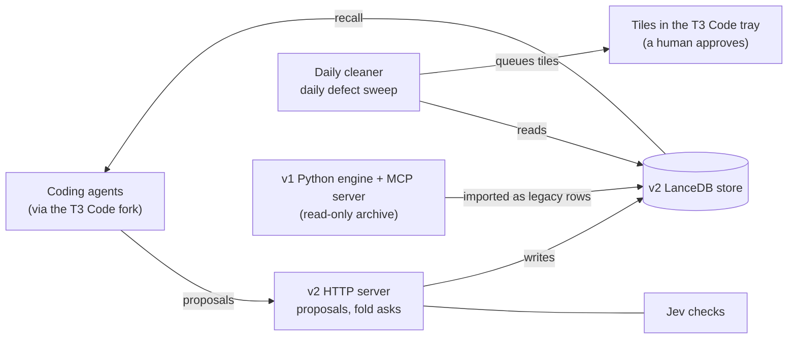

# Tabularium

Long-term memory for AI coding agents. It decides what is worth remembering, refuses near-duplicates, hands each agent the right notes at session start, and cleans out stale ones.

## Why

Storing and searching notes is the easy part. What decides whether a memory is any good is what gets saved, what gets refused, what each agent gets shown, and what gets cleaned up later. Tabularium owns that whole path instead of leaving it to the caller.

## How the parts connect



## How it works

### Records

A record is a durable note kept for later recall. A scope is one namespace per project. Reading in a scope also sees a reserved `global` scope.

There are three kinds:

- A fact is knowledge that may be revised and decays out of use.
- A decision records what was chosen and what was ruled out. Its content never changes. A change is a new decision that supersedes the old one, and the old one stays queryable as history.
- A defect is a bug an agent saw and left alone. It records where the bug is, what triggers it, the symptom, and why it was left. It moves from open to taken (an agent is working on it) to closed. Closing it takes a proposal whose excerpt is the proof of the fix. A daily sweep sends stale takes back to open.

The v1 engine has only facts and decisions. Defects came with v2.

In v2, a record that is only history can be archived. Recall skips it, but it can still be read and restored.

### Recall and session context

In v1, recall runs a vector search and a keyword search (BM25) in parallel and merges the two ranked lists with reciprocal rank fusion. Session context is a separate call. It builds the payload an agent gets at session start by filling a small hand-curated hot tier first, then a tier of transient nudges that fade if nothing references them. It filters by the agent's role and packs the result into a token budget.

In v2, recall is hybrid search over the v2 records and the legacy rows imported from v1, reranked by [Jev](https://typesafe.ai). It filters by record kind and by audience. The caller passes a short line about its current work, which feeds one extra vector search. Rows under a score floor drop out, up to five rows above a score line carry their claim, and the rest come back as headlines only.

### The save gate

Before a record is written, the gate embeds it and looks for near neighbours in the same scope. A neighbour at or above a cosine floor (0.80 for facts, 0.70 for decisions) is a survivor. In v1, an assessor judges the pair, or, with none configured, the save bounces. A bounce writes nothing. It returns the candidate and the exits the caller may take: reinforce the old record, confirm the two are distinct, or supersede it.

Four plain string checks (numbers, versions, named entities, negation) catch pairs that cosine similarity treats as one but that differ in a way that matters, such as "50 per page" against "100 per page".

In v2, with fold asks on, a fact or decision with a close live neighbour is held as a fold ask instead of being written. A human answers fold, which writes a merged record and supersedes the old one, or keep both. If nobody answers before the ask expires, the original is written as submitted.

### Jev checks

v2 sends each proposal to Jev: one request about the record and two per neighbour, for the nearest three. It asks four kinds of question:

- Gate questions: what kind of record it is, whether it is worth keeping, whether it is perishable, and who the reader is.
- Labels: audience, breadth, scope, purpose and topic.
- Shape checks: whether the headline matches the claim, whether the claim stands on its own, and whether the excerpt supports it.
- Neighbour checks: whether the new record restates, replaces or follows up the old one, and whether it covers it.

No flag blocks a save. A restatement suggests a reinforce, which applies at once. A replacement suggests a supersede, which waits on the proposal for the cleaner. An agent can also list up to five records its note replaces, and those are superseded at once. Without a key, or when a call times out or fails, proposals still apply with a `jev_unavailable` flag.

### The cleaner

The cleaner is a periodic pass over a scope that judges what the memory should stop holding. It has three axes:

- Relevance: records born since the last pass are graded against a rubric, and the ones not worth keeping are shelved. Shelved records leave recall but stay in the store.
- Falsity: a newer record is compared with older ones it may have overtaken, and a contradicted fact gets a supersession edge.
- Revisit: a rotation over old records, so a quiet scope still gets its old records looked at.

Two judges from different model families grade independently, and disagreements are handled by policy. The rubric is a TOML file hashed into a version that is stamped on every verdict. The pass advances its watermark only after it re-reads every write it made and finds it present.

In v2, the cleaner runs daily and queues merge, supersede, retire and promote suggestions as tiles. A defect sweep runs daily and queues a close tile for each defect open for 90 days. A human approves or rejects each tile in the T3 Code tray.

### Storage and testing

LanceDB is the production store, behind a storage port. An in-memory adapter implements the same port for tests, and one conformance suite runs against both.

The default Python test lane is hermetic. Embeddings come from a frozen fixture of vectors built from a small synthetic corpus, so no test needs Ollama or a network. The same lane enforces recall and precision floors on that corpus and a precision floor on the gate's golden pairs. Those floors are regression gates, not quality claims about real data. The assessor sits behind a seam too, and the tests pass small stand-ins for it.

### v1 to v2

v1 is the Python engine with an MCP server. The server exposes four read tools and no write tools, and its store is now a read-only archive. v2 is a separate TypeScript server with its own store. It has no MCP surface. Agents reach it over plain HTTP from my fork of [T3 Code](https://github.com/pingdotgg/t3code), [simkaz12/t3code](https://github.com/simkaz12/t3code), through the memory tools and tray the fork adds. Records imported from v1 sit in a separate legacy table that v2 recall searches alongside its own records. Legacy rows never change through the API and drop out of recall once a v2 record replaces them.

## Status

This is a solo project that I use every day for my own coding agents. It is a public snapshot of a private repository, with the history squashed and the personal data removed. It is an experiment, not a product. Whether it beats having no memory layer at all is a hypothesis I am still testing on myself. The results below do not settle it.

## Results

Two evals, each run once. Treat them as a snapshot, not a verdict.

### PersonaMem-v2 (public benchmark)

147 multiple-choice questions about 5 simulated users from [PersonaMem-v2](https://huggingface.co/datasets/bowen-upenn/PersonaMem-v2). Notes were extracted once from the chat histories, and v1 and v2 each stored the same 746 notes. For every question a reader model (Claude Opus) answered using only what that setup recalled.

| Setup | All 147 | 62 "forget" questions | Other 85 |
| --- | --- | --- | --- |
| No memory | 40.1% | 0.0% | 69.4% |
| v1 | 69.4% | 80.6% | 61.2% |
| v2 (with rerank) | 70.1% | 79.0% | 63.5% |
| Full chat history | 81.0% | 93.5% | 71.8% |

- v1 and v2 score the same within noise. v2 minus v1 is +0.7 points, with a 95% interval of -5.4 to +6.8.
- The whole gain over no memory comes from the 62 forget questions, where the user asked for something to be forgotten. On the other 85, both memory setups scored lower than no memory (61 to 64% against 69.4%). I did not test whether that gap is significant.
- Full chat history is the ceiling: the reader sees everything. Between no memory (40.1%) and that ceiling (81.0%), v1 closed 72% of the gap and v2 closed 73%.

The scripts are in [`scripts/eval_v1v2/pmv2/`](scripts/eval_v1v2/pmv2/). A rerun needs Ollama, the Claude CLI and a Jev key, and the model answers vary between runs.

### Duplicate handling (my own data)

202 pairs of an existing note and a new similar one, taken from my own store, where two LLM judges agreed on what should happen (Cohen's kappa 0.77). This ran on a build from before fold asks. The data is private, so it cannot be rerun from this repo.

| | v1 | v2 |
| --- | --- | --- |
| Notes wrongly merged away | 0 of 202 | 0 of 202 |
| False alarms: pairs that should both be kept, flagged anyway | 89 of 121 (74%) | 4 of 121 (3%) |
| Repeats caught or flagged | 34 of 39 (87%) | 26 of 39 (67%) |
| Replacements flagged | 41 of 42 (98%) | 36 of 42 (86%) |

v2 interrupts the agent far less often but misses more repeats and replacements. 120 of the 242 candidate pairs came from v1's own bounce log, which pushes v1's flag rates up.

## Quick start

You need Python 3.12 or newer, [uv](https://docs.astral.sh/uv/), and for real embeddings an [Ollama](https://ollama.com) server with `nomic-embed-text` on `localhost:11434`.

```bash
uv sync
export TABULARIUM_STORE_PATH=/tmp/tabularium-demo
uv run tabularium scope add demo
uv run tabularium doctor
uv run tabularium-mcp
```

The v2 server has its own start commands in [`v2/README.md`](v2/README.md).

## Learn more

- [`docs/how-it-works.md`](docs/how-it-works.md): records, recall, the save gate, the cleaner, storage, the eval bench and deploy
- [`v2/README.md`](v2/README.md): the TypeScript server, its configuration and API
- [`scripts/eval_v1v2/README.md`](scripts/eval_v1v2/README.md): the bench that compares v1 and v2
- [`docs/adr/`](docs/adr/): historical design records
- [`CONTEXT.md`](CONTEXT.md): glossary of the domain terms

## Tests

```bash
uv run pytest          # default lane, no network, no Ollama
uv run ruff check
uv run mypy .

cd v2 && npm ci && npm run typecheck && npm test
```

## Credits

v2 is built for my fork, [simkaz12/t3code](https://github.com/simkaz12/t3code), of [T3 Code](https://github.com/pingdotgg/t3code). T3 Code is made by T3 Tools Inc. ([Ping.gg](https://ping.gg/)), built by [Theo Browne](https://github.com/t3dotgg), [Julius Marminge](https://github.com/juliusmarminge) and its contributors, and released under the MIT license.

## License

MIT. See [LICENSE](LICENSE).
